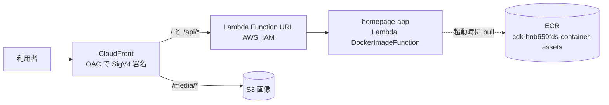

# 2026/10/24〜10/30 サイト停止障害の記録 — 何が起きて、どう直したか

## この記事の前提

- **対象**: 本番サイト `https://www.okamomedia.tokyo/`（homepage v2）
- **障害期間**: 2026/10/24 22:00 ごろ 〜 2026/10/30 05:47（日本時間、**約5日半**）
- **原因の種類**: アプリのバグではない。**Lambda が起動に使う Docker イメージが ECR から消えていた**（ECR のライフサイクルポリシーが原因）
- **ソースコード**: 変更なし（`main` = `v2.1.0`。復旧もこのコミットからの再ビルドで実施）
- **想定読者**: エンジニアだが、AWS のコンテナ／サーバーレス周りは詳しくない方。用語は末尾の「用語集」にまとめています

> この記事のゴールは「同じ構成で同じ事故を起こさないこと」。細かい API 仕様よりも、
> **どこで何が起きて、なぜ気づけなかったのか**が追えるように書いています。

---

## 結論（先に3行）

1. `homepage-app`（Next.js を **Lambda Web Adapter + Docker イメージ**で動かしている Lambda）は、起動時に **ECR からイメージを pull** する。そのイメージが消えていたため起動できず、全ページが 502 になった
2. アプリのコードに問題はなく、**同じコミットからイメージを作り直して差し替えるだけ**で復旧した（約15分）
3. 引き金は ECR に設定していた **「最新5イメージのみ保持」のライフサイクルポリシー**。容量対策として良かれと思って入れたが、**その ECR リポジトリは3プロジェクトの共有**で、他プロジェクトのデプロイで自分のイメージが押し出されることに気づいていなかった

---

## 1. 利用者から見えていた症状

| 見え方 | 実際に起きていたこと |
| --- | --- |
| トップページに英語のエラー `{"Type":"User","message":"The server encountered an error and could not complete your request"}` | サイトのプログラムが起動できず、中継役（CloudFront）が返す汎用エラー（**502 Bad Gateway**）だった |
| ページによっては画像だけ表示された | 画像は S3 オリジン（`/media/*`）から配信しているため無事だった |
| 管理画面・API も同じエラー | 同じプログラムが担当しているため全滅 |

エラー率（サーバーエラーが出た割合）の推移:

> 指標は CloudFront の `5xxErrorRate`（リクエスト単位の率）の**日次 Average**、日付は **JST の暦日**で集計。
> 障害の途中で始まる/終わる日（10/24・10/30）は、24 時間のうち一部だけが障害時間なので割合が薄まる。

| 日付（JST） | エラー率（日次平均） |
| --- | --- |
| 10/23 まで | 0%（平常） |
| 10/24 | 3.9%（22:00 からの 2 時間分） |
| 10/25 | 64.2% |
| 10/26 | 93.9% |
| 10/27 | 72.4% |
| 10/28 | 71.9% |
| 10/29 | 86.2% |
| 10/30 | 33.7%（05:47 に復旧） |

> 100% にならないのは、画像やキャッシュ済みのファイルが正常に返っていたためです。
> 「一部だけ壊れている」ように見えるのが、かえって原因究明を難しくしました。

---

## 2. 時系列（障害発生 → 復旧）

### 発生まで

| 日時（JST） | 出来事 |
| --- | --- |
| 10/23 21:52 | 本番サイトの最後の更新（`v2.1.0` をデプロイ）。この時点で正常稼働 |
| 10/24 12:13〜16:11 | **別プロジェクト2件**（Newcleus / Kiln）が、*同じ ECR リポジトリ* へ新しいイメージを合計5個 push |

### 障害発生

| 日時（JST） | 出来事 | 影響 |
| --- | --- | --- |
| 10/24 21時台まで | 正常稼働（1日のアクセス約600件） | なし |
| **10/24 22:00 ごろ** | **ECR のライフサイクル評価**が実行され、本サイトのイメージが失効。Lambda が「参照先のイメージが存在しない」状態（`Inactive` / `ImageDeleted`）に | **エラー率 55%** に急上昇 |
| 10/25〜10/29 | 参照先が無いまま。アクセスはすべてエラー | エラー率 66〜89% で継続 |

### 復旧作業（10/30 早朝）

| 時刻（JST） | 作業 | 結果 |
| --- | --- | --- |
| 05:32 | 利用者からの報告を受け、外部からのアクセスで症状を再現 | 502 とエラー本文を確認 |
| 05:35 | 切り分け（中継役かアプリか）→ サーバーの状態を確認 | **`Inactive` / `ImageDeleted`（イメージ削除済み）** を特定 |
| 05:36 | 「アプリの不具合ではなく、保管庫の整理設定が原因」と断定 | コード・設定のドリフトが無いことも確認（差分ゼロ） |
| 05:40 | 現在のコード（`main` = `v2.1.0`）から**Docker イメージを再ビルド** | 成功 |
| 05:46 | 保管庫（ECR）へ再登録 | 成功 |
| 05:47 | サーバーの参照先を新しいイメージに差し替え | **`Active` に復帰・サイト復旧** |
| 05:48 | 画面・記事ページ・法務ページ・管理画面・API を実機確認 | すべて 200（正常） |
| 05:50 | **ライフサイクルポリシーを CDK bootstrap 既定に戻す**（再発防止） | 完了 |

**復旧までに要した作業時間: 約15分**（調査開始から）

---

## 3. 原因

### このサイトの構成（最低限の前提）



- Next.js アプリは **Docker イメージ**にして ECR に置き、**Lambda（DockerImageFunction）**として動かしている
- ブラウザとの HTTP のやり取りは **Lambda Web Adapter** が Lambda 呼び出しに変換する（アプリは `:3000` で待ち受けるだけ）
- CloudFront は **OAC** で Function URL に SigV4 署名してアクセスする（Function URL は `AWS_IAM` 認証）
- したがって **ECR のイメージは「起動に必須の部品」**。消えると Lambda は 1 度も起動できない

> ここが今回の肝: Lambda は「エラーを返していた」のではなく **「起動できていなかった」**。
> だからアプリのログには何も残らず、Lambda の `Errors` メトリクスも 0 のままだった。

### 何が起きたか

```
ECR リポジトリ cdk-hnb659fds-container-assets-210387976006-ap-northeast-1 に
「最新5イメージのみ保持」のライフサイクルポリシーが設定されていた（手動設定）
        ↓
このリポジトリは CDK bootstrap が作る「アカウント共有のアセット置き場」で、
homepage / Newcleus / Kiln の 3 プロジェクトが同じ場所へ push している
        ↓
10/24 に他2プロジェクトがデプロイし、新しいイメージが合計5個 push された
        ↓
日次のライフサイクル評価で、homepage のイメージ（タグ 6bd42eca… / digest d9ca4fe6…）が
「最新5個」の外に押し出されて失効
        ↓
Lambda homepage-app が State=Inactive / StateReasonCode=ImageDeleted に
        ↓
CloudFront → Function URL が 502 BadGatewayException を返し続ける
```

### ポイント

- **アプリのコードは壊れていない**。ECR からイメージが消えただけ
- そのため「同じコミットからイメージを作り直して、Lambda の参照先を差し替える」だけで直る
- 逆に言うと、**コードを直しても CDK の設定を直しても直らない**（消えたイメージが戻らない限り）

### なぜこの設定をしたのか、何を見落としたか

「最新5イメージだけ残す」は、**不要なイメージが溜まって ECR のストレージ課金が膨らむのを防ぐための、良かれと思って入れた設定**でした。発想自体はよくある容量管理で、間違いではありません。抜けていたのは前提条件です。

| 見落とし | 実際の挙動 |
| --- | --- |
| **ECR リポジトリが共有だった** | `cdk-hnb659fds-container-assets-<account>-<region>` は CDK bootstrap が作る**アカウント/リージョン共通**のアセット置き場。qualifier（`hnb659fds`）が同じ CDK アプリは全部ここへ push する。実際に `homepage-app` / `newcleus-app` / `bar-kiln-site` が同居していた |
| **「5個」は自プロジェクト分ではなかった** | ライフサイクルはリポジトリ全体を数える。他プロジェクトの push も同じ5枠を消費する（description は「CDK がデプロイ毎に追加するため」＝自プロジェクト分だけを数える想定だった） |
| **ライフサイクルは「使用中か」を判定しない** | 判定材料は「タグの有無・push 日時・件数」だけ。Lambda が参照中でも expire 対象になる |
| **CDK bootstrap の既定を上書きしていた** | 既定は `untagged` を 365 日で失効（＝タグ付き＝使用中には触らない）。これが唯一の安全網だったが、置き換えたことで外れた |

本質は、**「このリポジトリは自分だけが使う」という前提が崩れていた**ことです。前提が違えば、同じ設定でも結果は正反対になります（安全な容量管理 → 稼働中イメージの削除）。

### 実測した事実

Lambda が一度も起動していないことは CloudWatch の `Invocations`（10/24 21時台を最後にゼロ）で確認した。

---

## 4. なぜ5日間だれも気づかなかったのか

| 要因 | 説明 |
| --- | --- |
| **監視アラームが無かった**（当時） | 「エラー率が上がったら通知する」設定が未整備。今回は利用者の報告で初めて判明した。※現在は CloudFront 5xx 率と Lambda `Errors` のアラームを追加済み |
| エラーの見た目がアプリのエラーに似ていた | 中継役（CloudFront）が返す汎用メッセージで、セキュリティヘッダも正常に付いていたため「アプリが落ちている」ように見えた |
| 一部だけ正常だった | 画像は別経路のため表示され続け、「ちょっと調子が悪い」程度に見えた |
| 自動テストの守備範囲外 | CI（自動テスト）は「コードの正しさ」を見るが、「配布物（ECR のイメージ）が残っているか」は見ていない |
| 静かに壊れる種類の障害 | デプロイ直後ではなく**数日後に**壊れるため、直近の変更を疑いにくい |

---

## 5. 復旧作業の内容（何をして、何をしなかったか）

### やったこと

| 手順 | 内容 |
| --- | --- |
| 1 | 症状の切り分け（中継役か、アプリか、サーバーか） |
| 2 | Lambda の状態確認 → 「イメージ削除済み（`ImageDeleted`）」を特定 |
| 3 | 現在のコード（`main` = `v2.1.0`）から Docker イメージを再ビルド（約6分） |
| 4 | ECR へ push |
| 5 | Lambda の参照先イメージを差し替え |
| 6 | 実機での動作確認（トップ / 記事 / 法務ページ / 管理画面 / API） |
| 7 | ライフサイクルポリシーを CDK bootstrap 既定へ戻す |

### あえて触らなかったもの

独自ドメイン設定、SSL 証明書、WAF、データベース、環境変数、ソースコード。
**設定類には一切手を付けていない**ため、復旧作業による二次的な影響はありません。

---

## 6. 再発防止策

### 実施済み（今回対応）

| 対策 | 内容 |
| --- | --- |
| **ECR のライフサイクルポリシーを是正** | 「最新5イメージのみ保持」→ **`untagged` を 365 日で失効（CDK bootstrap 既定）** に変更。**タグ付き（＝使用中）のイメージは絶対に失効しない**設定になった |
| **監視アラームの追加** | 異常をメール通知する仕組みを追加（下記）。ただし **この障害を検知するのは CloudFront 5xx 率の 1 本だけ**で、Lambda Errors は「起動していない」ケースでは鳴らない |
| **障害対応手順書への追記** | `docs/operations_v2.md` に「障害時の切り分け（502 / サイト停止）」を追加。「この症状では“イメージ消失”を最初に疑う」「通常のデプロイ操作（`cdk deploy`）では直らない」を明文化 |
| **社内ドキュメントの誤記修正** | 手順書に書かれたスタック名が実際と異なっていた（`HomepageInfraStack` → 実際は `HomepageDynamoDbStack`）。あわせて AI エージェント向け指示書に再発防止ルールを追記 |

追加した監視（CDK スタックとして管理）:

| アラーム | 条件 | 何を検知するか | 今回の障害で鳴るか |
| --- | --- | --- | --- |
| `homepage-cloudfront-5xx-rate` | 5xx 率 5% 以上が10分継続 | **起動不能・オリジン異常**（Lambda が 1 度も起動しない 502 を含む） | **鳴る**（＝これが本命） |
| `homepage-app-lambda-errors` | Lambda の例外が 5 分間に 1 件以上 | **実行時例外**（起動はするがハンドラが落ちるケース） | **鳴らない**（`Invocations` が 0 → `Errors` も 0 のまま） |

> **「2 本あるから安心」ではない。** 起動不能系を検知できるのは **CloudFront 5xx 率の 1 本だけ**で、
> しかもこれは「アクセスがあること」が前提。無トラフィックの時間帯までカバーするには外形監視
> （Route53 ヘルスチェック等）を足す必要がある（下記の推奨）。

通知はメール（SNS）。CloudFront のメトリクスは us-east-1 にしか存在せず、さらに「アラームの通知先も us-east-1」でないと作成できない API 制約があるため、監視用スタックは 2 つに分けている（`HomepageMonitoringStack` / `HomepageMonitoringEdgeStack`）。

### 推奨（未実施・今後対応したいもの）

| 対策 | なぜ必要か |
| --- | --- |
| **プロジェクト毎に ECR を分離** | CDK bootstrap の共有アセットリポジトリ依存をやめ、自前リポジトリ + CI push にする。他人の都合で消えない構成にする（中期的な課題） |
| **外形監視（ヘルスチェック）の追加** | アクセスがゼロの時間帯は 5xx 率にデータが無く、アラームが発火しない。Route53 ヘルスチェック等で「無トラフィックでも異常を検知」できるようにする |

---

## 7. 今回の教訓（一般化）

1. **自動で掃除する設定に「件数上限」を入れると、必ず事故る**
   「最新○件だけ残す」は、そのイメージが使われているかいないかを見ていない。特に ECR のように複数プロジェクトで共有しがちな場所では危険。
2. **壊れたら最初に「アプリか、インフラか」を決める**
   アプリを疑ってコードを読み始めると、今回のようなケースでは時間を溶かす。
3. **静かに壊れる障害には、アラームが必須**
   今回の障害は「デプロイした瞬間」ではなく「数日後」に来た。人の注意力では防げない。
4. **正常に見える部分が、犯人を隠す**
   画像だけ表示されていたことで「一部の不具合」に見えた。部分的に動く障害ほど疑いを持つ。

---

## 8. 今回の障害と「リリース（WSL イメージ配布）」の関係

- 本障害は**アプリのコードや配布物（GitHub で配布している WSL イメージ）とは無関係**です
- 復旧に使ったのは配布中と同じコード（`v2.1.0`）を再ビルドしたものなので、**バージョンは変わっていません**
- したがって **緊急の再リリースは不要**です
- 次回の通常リリース時に、本記録を「既知の運用情報」として参照・案内いただければ十分です

---

## 9. 用語集

| 用語 | この記事での意味 |
| --- | --- |
| **Docker イメージ** | アプリと実行環境をまとめた実行単位。ここでは Next.js のビルド成果物 + Node.js + Lambda Web Adapter |
| **ECR** | Docker イメージを保管する AWS のレジストリ。Lambda は起動時にここから pull する |
| **ECR ライフサイクルポリシー** | 「最新○件だけ残す」「○日経過したものを削除」等を自動実行するルール。**使用中かどうかは見ない** |
| **CDK bootstrap** | CDK がデプロイに使う土台（IAM ロール、アセット用 S3 / ECR）。アカウント＋リージョン＋qualifier 単位で**全プロジェクト共通** |
| **Lambda（DockerImageFunction）** | イメージを指定して作る Lambda。zip デプロイと違い、イメージが無いと起動できない |
| **Lambda Web Adapter** | 普通の HTTP サーバー（Next.js の `server.js`）を Lambda 上で動かすための拡張 |
| **Lambda Function URL** | Lambda に HTTPS エンドポイントを付ける機能（ここでは `AuthType: AWS_IAM`） |
| **CloudFront OAC** | CloudFront からオリジンへ **SigV4 署名付き**でアクセスする仕組み（viewer 側の署名は不要） |
| **502 Bad Gateway** | 中継役が「オリジンから正常な応答が返らない」と判断したステータス。**アプリが返しているとは限らない** |
| **`State=Inactive` / `ImageDeleted`** | Lambda の状態。参照先のイメージが存在しないときの値 |

---

## 付録: 技術的な証拠（生データ）

### 症状の観測値

```
$ curl -I https://www.okamomedia.tokyo/
HTTP/2 502
x-amzn-errortype: BadGatewayException
x-cache: Error from cloudfront        ← CloudFront が返したエラー（アプリ由来ではない）
server: CloudFront
```

### サーバーの状態

```
FunctionName   : homepage-app
State          : Inactive
StateReason    : The function is trying to use a deleted image.
StateReasonCode: ImageDeleted
ImageUri       : ...cdk-hnb659fds-container-assets-...:6bd42eca…   ← 既に存在しない
```

### ECR の状況

- リポジトリ: `cdk-hnb659fds-container-assets-210387976006-ap-northeast-1`（**アカウント/リージョン共有**）
- 同居していた関数: `homepage-app` / `newcleus-app` / `bar-kiln-site`
- 旧ポリシー（手動設定・リポジトリ内に痕跡なし）:

```json
{"rules":[{"rulePriority":1,
  "description":"最新5イメージのみ保持（CDK がデプロイ毎に追加するため）",
  "selection":{"tagStatus":"any","countType":"imageCountMoreThan","countNumber":5},
  "action":{"type":"expire"}}]}
```

- 新ポリシー（CDK bootstrap 既定に復帰）:

```json
{"rules":[{"rulePriority":1,
  "description":"Untagged images should not exist, but expire any older than one year",
  "selection":{"tagStatus":"untagged","countType":"sinceImagePushed","countUnit":"days","countNumber":365},
  "action":{"type":"expire"}}]}
```

### 切り分けの根拠

- CloudFormation `HomepageDynamoDbStack` は `UPDATE_COMPLETE`、`cdk diff` は**差分ゼロ**
  → コード／インフラ定義のドリフトではない（＝「イメージ実体の欠損」だけが異常）
- Lambda `Invocations` は 10/24 21時台を最後にゼロ、CloudFront `5xxErrorRate` は 10/24 22:00 台から急上昇
- CloudFront の 5xx は「Lambda オリジン宛だけ」発生（S3 オリジンの `/media/*` は正常）

### 復旧コマンド（実施内容）

```bash
# 1) ビルド（Lambda は linux/amd64 必須、マニフェストは index/list 不可）
docker build --platform linux/amd64 -t <repo>:ops-<epoch> -f Dockerfile .
# 2) 登録
docker push <repo>:ops-<epoch>
# 3) 参照先の差し替え（Function URL / 環境変数 / IAM は不変）
aws lambda update-function-code --function-name homepage-app --image-uri <repo>:ops-<epoch>
aws lambda wait function-updated --function-name homepage-app
```

> 注意: この復旧は `docs/operations_v2.md` の「アプリコード更新」と同じ経路。
> **`cdk deploy` では復旧しない**（テンプレートに差分が無いため CloudFormation が
> `UpdateFunctionCode` を呼ばない）。

---

## 前提が変わったときの注意

| 前提 | 崩れた場合に起こること／変えるべきこと |
| --- | --- |
| ECR のライフサイクルは「`untagged` を 365 日で失効」（CDK bootstrap 既定） | 件数・期間ベース（`tagStatus: any/tagged`）に戻すと**同じ障害が再発**する。共有リポジトリでは特に禁止 |
| アセット用 ECR は 3 プロジェクトで共有 | プロジェクトが増えるほど他人の push で押し出されるリスクが上がる。増やすなら ECR 分離（自前リポジトリ + CI push）を先に検討 |
| 監視は CloudFront 5xx 率 + Lambda `Errors`（`HomepageMonitoringStack` / `HomepageMonitoringEdgeStack`）。通知先は `.env` の `ALARM_EMAIL`（未設定なら通知しない） | 無トラフィック時は 5xx 率にデータが無く発火しない。外形監視（Route53 ヘルスチェック等）を足すまでこの穴は残る |
| Lambda のイメージは CDK のアセットタグではなく `ops-<epoch>` 等で差し替えている場合がある | 次回の構造変更デプロイで CDK ビルドのイメージへ戻る（想定どおりの挙動） |
| アプリのコードは `v2.1.0` のまま | コードを変更して再ビルドした場合は、配布中の WSL イメージとの差分確認が必要 |
