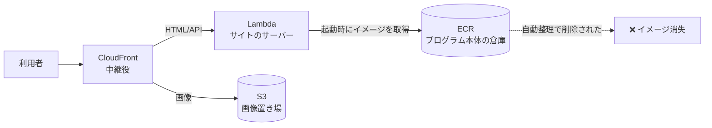

# 2026/10/24〜10/30 サイト停止障害の記録 — 何が起きて、どう直したか

## この記事の前提

- **対象**: 本番サイト `https://www.okamomedia.tokyo/`
- **障害期間**: 2026/10/24 22:00 ごろ 〜 2026/10/30 05:47（日本時間、**約5日半**）
- **原因の種類**: アプリ（プログラム）のバグではなく、**AWS 上の「配布物の保管庫」の自動整理設定**による、プログラム本体の誤削除
- **ソースコード**: 一切変更なし（`main` = `v2.1.0` のまま。復旧もこのバージョンの再ビルドで実施）
- **想定読者**: エンジニアでない方。専門用語は末尾の「用語ミニ辞典」にまとめています

---

## 結論（先に3行）

1. サイトの画面を表示するプログラム本体（**コンテナイメージ**）が、AWS の**自動整理機能**によって削除されていた
2. プログラムにバグはなく、コードも無変更。**同じコードから作り直して差し替えるだけ**で復旧した
3. 引き金は「保管庫の整理ルール」を人が手で厳しくし過ぎたこと。**ルールを元に戻して再発防止**した

---

## 1. 利用者から見えていた症状

| 見え方 | 実際に起きていたこと |
| --- | --- |
| トップページに英語のエラー `{"Type":"User","message":"The server encountered an error and could not complete your request"}` | サイトのプログラムが起動できず、中継役（CloudFront）が返す汎用エラー（**502 Bad Gateway**）だった |
| ページによっては画像だけ表示された | 画像は別の保管場所（S3）から配信しているため無事だった |
| 管理画面・API も同じエラー | 同じプログラムが担当しているため全滅 |

エラー率（サーバーエラーが出た割合）の推移:

| 日付 | エラー率（日次平均） |
| --- | --- |
| 10/22〜10/23 | 0%（平常） |
| 10/24 | 12%（この日の夜から発生） |
| 10/25 | 66% |
| 10/26 | 73% |
| 10/27 | 86% |
| 10/28 | 72% |
| 10/29 | 89% |
| 10/30 05:47 以降 | 0%（復旧） |

> 100% にならないのは、画像やキャッシュ済みのファイルが正常に返っていたためです。
> 「一部だけ壊れている」ように見えるのが、かえって原因究明を難しくしました。

---

## 2. 時系列（障害発生 → 復旧）

### 発生まで

| 日時（JST） | 出来事 |
| --- | --- |
| 10/23 21:52 | 本番サイトの最後の更新（`v2.1.0` をデプロイ）。この時点で正常稼働 |
| 10/24 12:13〜16:11 | **別プロジェクト2件**（Newcleus / Kiln）が、*同じ保管庫* に新しいプログラム本体を合計5個登録 |

### 障害発生

| 日時（JST） | 出来事 | 影響 |
| --- | --- | --- |
| 10/24 21時台まで | 正常稼働（1日のアクセス約600件） | なし |
| **10/24 22:00 ごろ** | AWS の**自動整理**が実行され、本サイトのプログラム本体が削除。サーバー（Lambda）が「参照先のイメージが存在しない」状態（`Inactive` / `ImageDeleted`）に | **エラー率 55%** に急上昇 |
| 10/25〜10/29 | 参照先が無いまま。アクセスはすべてエラー | エラー率 66〜89% で継続 |

### 復旧作業（10/30 早朝）

| 時刻（JST） | 作業 | 結果 |
| --- | --- | --- |
| 05:32 | 利用者からの報告を受け、外部からのアクセスで症状を再現 | 502 とエラー本文を確認 |
| 05:35 | 切り分け（中継役かアプリか）→ サーバーの状態を確認 | **`Inactive` / `ImageDeleted`（イメージ削除済み）** を特定 |
| 05:36 | 「アプリの不具合ではなく、保管庫の整理設定が原因」と断定 | コード・設定のドリフトが無いことも確認（差分ゼロ） |
| 05:40 | 現在のコード（`main` = `v2.1.0`）から**プログラム本体を再ビルド** | 成功 |
| 05:46 | 保管庫（ECR）へ再登録 | 成功 |
| 05:47 | サーバーの参照先を新しいイメージに差し替え | **`Active` に復帰・サイト復旧** |
| 05:48 | 画面・記事ページ・法務ページ・管理画面・API を実機確認 | すべて 200（正常） |
| 05:50 | **整理ルールを AWS 標準に戻す**（再発防止） | 完了 |

**復旧までに要した作業時間: 約15分**（調査開始から）

---

## 3. 原因（たとえ話で）

### 起きたこと

```
レンタル倉庫（＝Amazon ECR）に「最新5箱だけ残す」という自動整理ルールが設定されていた
        ↓
その倉庫は 3つのプロジェクトで共有していた（本サイト / Newcleus / Kiln）
        ↓
10/24 に他2プロジェクトが新しい箱を5つ搬入
        ↓
「最新5箱」に入れなかった本サイトの箱が、翌日の自動整理で処分された
        ↓
本サイトのサーバーは「箱を開けて動く」仕組みなので、箱が無いと起動できない
        ↓
→ すべてのページが 502 エラー
```

### ポイント

- **プログラム自体は壊れていない**。倉庫から箱（プログラム本体）が消えただけ
- そのため「箱を作り直して、サーバーの参照先を差し替える」だけで直る
- 逆に言うと、**コードを直しても設定を直しても直らない**（消えた箱が戻らない限り）

### 図（技術者向け）



---

## 4. なぜ5日間だれも気づかなかったのか

| 要因 | 説明 |
| --- | --- |
| **監視アラームが無かった** | 「エラー率が上がったら通知する」設定が未整備。今回は利用者の報告で初めて判明した |
| エラーの見た目がアプリのエラーに似ていた | 中継役（CloudFront）が返す汎用メッセージで、セキュリティヘッダも正常に付いていたため「アプリが落ちている」ように見えた |
| 一部だけ正常だった | 画像は別経路のため表示され続け、「ちょっと調子が悪い」程度に見えた |
| 自動テストの守備範囲外 | CI（自動テスト）は「コードの正しさ」を見るが、「配布物が倉庫に残っているか」は見ていない |
| 静かに壊れる種類の障害 | デプロイ直後ではなく**数日後に**壊れるため、直近の変更を疑いにくい |

---

## 5. 復旧作業の内容（何をして、何をしなかったか）

### やったこと

| 手順 | 内容 |
| --- | --- |
| 1 | 症状の切り分け（中継役か、アプリか、サーバーか） |
| 2 | サーバーの状態確認 → 「イメージ削除済み」を特定 |
| 3 | 現在のコード（`main` = `v2.1.0`）からプログラム本体を再ビルド（約6分） |
| 4 | 保管庫（ECR）へ再登録 |
| 5 | サーバー（Lambda）の参照先を新しいイメージへ差し替え |
| 6 | 実機での動作確認（トップ / 記事 / 法務ページ / 管理画面 / API） |
| 7 | 整理ルールを AWS 標準へ戻す |

### あえて触らなかったもの

独自ドメイン設定、SSL 証明書、WAF、データベース、環境変数、ソースコード。
**設定類には一切手を付けていない**ため、復旧作業による二次的な影響はありません。

---

## 6. 再発防止策

### 実施済み（今回対応）

| 対策 | 内容 |
| --- | --- |
| **整理ルールの是正** | 「最新5個だけ残す」→ **AWS 標準（1年以上前の“ラベルなし”イメージのみ削除）** に変更。**使用中のプログラムは絶対に消えない**設定になった |
| **障害対応手順書への追記** | `docs/operations_v2.md` に「障害時の切り分け（502 / サイト停止）」を追加。「この症状では“イメージ消失”を最初に疑う」「通常のデプロイ操作（`cdk deploy`）では直らない」を明文化 |
| **社内ドキュメントの誤記修正** | 手順書に書かれたスタック名が実際と異なっていた（`HomepageInfraStack` → 実際は `HomepageDynamoDbStack`）。あわせて AI エージェント向け指示書に再発防止ルールを追記 |

### 推奨（未実施・今後対応したいもの）

| 対策 | なぜ必要か |
| --- | --- |
| **監視アラームの追加** | 「エラー率が5%を超えたら通知」。今回は5日間放置された。次は数分で気づける状態にしたい |
| **プロジェクト毎に保管庫を分離** | そもそも他人のプロジェクトの都合で消えない構成にする（中期的な課題） |

---

## 7. 今回の教訓（一般化）

1. **自動で掃除する設定に「件数上限」を入れると、必ず事故る**
   「最新◯件だけ残す」は、使われているかいないかを見ていない。共有の保管場所では特に危険。
2. **壊れたら最初に「アプリか、インフラか」を決める**
   アプリを疑ってコードを読み始めると、今回のようなケースでは時間を溶かす。
3. **静かに壊れる障害には、アラームが必須**
   今回の障害は「デプロイした瞬間」ではなく「数日後」に来た。人の注意力では防げない。
4. **正常に見える部分が、犯人を隠す**
   画像だけ表示されていたことで「一部の不具合」に見えた。部分的に動く障害ほど疑いを持つ。

---

## 8. 今回の障害と「リリース（WSL イメージ配布）」の関係

- 本障害は**アプリのコードや配布物（GitHub で配布している WSL イメージ）とは無関係**です
- 復旧に使ったのは配布中と同じコード（`v2.1.0`）を再ビルドしたものなので、**バージョンは変わっていません**
- したがって **緊急の再リリースは不要**です
- 次回の通常リリース時に、本記録を「既知の運用情報」として参照・案内いただければ十分です

---

## 9. 用語ミニ辞典

| 用語 | かみくだいた説明 |
| --- | --- |
| **コンテナイメージ** | プログラムと実行環境をひとまとめにした「箱」。この箱を開けるとサイトが動く |
| **ECR** | その箱を保管しておく倉庫（AWS のサービス） |
| **Lambda** | アクセスが来たら倉庫から箱を開けて動くサーバー。箱が無いと起動できない |
| **CloudFront** | 利用者とサーバーの間に立つ中継役。速く届ける役割と、サーバーが落ちたときにエラーを返す役割がある |
| **ライフサイクルポリシー** | 倉庫の「自動整理ルール」。古い箱を自動で処分する設定 |
| **502 Bad Gateway** | 中継役が「サーバーからまともな応答が返ってこない」と判断したときのエラー |
| **デプロイ** | 新しいプログラムを本番環境に配置すること |

---

## 付録: 技術的な証拠（エンジニア向け）

### 症状の観測値

```
$ curl -I https://www.okamomedia.tokyo/
HTTP/2 502
x-amzn-errortype: BadGatewayException
x-cache: Error from cloudfront        ← CloudFront が返したエラー（アプリ由来ではない）
server: CloudFront
```

### サーバーの状態

```
FunctionName   : homepage-app
State          : Inactive
StateReason    : The function is trying to use a deleted image.
StateReasonCode: ImageDeleted
ImageUri       : ...cdk-hnb659fds-container-assets-...:6bd42eca…   ← 既に存在しない
```

### 保管庫（ECR）の状況

- リポジトリ: `cdk-hnb659fds-container-assets-210387976006-ap-northeast-1`（**アカウント/リージョン共有**）
- 同居していた関数: `homepage-app` / `newcleus-app` / `bar-kiln-site`
- 旧ポリシー（手動設定・リポジトリ内に痕跡なし）:

```json
{"rules":[{"rulePriority":1,
  "description":"最新5イメージのみ保持（CDK がデプロイ毎に追加するため）",
  "selection":{"tagStatus":"any","countType":"imageCountMoreThan","countNumber":5},
  "action":{"type":"expire"}}]}
```

- 新ポリシー（CDK bootstrap 既定に復帰）:

```json
{"rules":[{"rulePriority":1,
  "description":"Untagged images should not exist, but expire any older than one year",
  "selection":{"tagStatus":"untagged","countType":"sinceImagePushed","countUnit":"days","countNumber":365},
  "action":{"type":"expire"}}]}
```

### 切り分けの根拠

- CloudFormation `HomepageDynamoDbStack` は `UPDATE_COMPLETE`、`cdk diff` は**差分ゼロ**
  → コード／インフラ定義のドリフトではない（＝「イメージ実体の欠損」だけが異常）
- Lambda `Invocations` は 10/24 21時台を最後にゼロ、CloudFront `5xxErrorRate` は 10/24 22:00 台から急上昇
- CloudFront の 5xx は「Lambda オリジン宛だけ」発生（S3 オリジンの `/media/*` は正常）

### 復旧コマンド（実施内容）

```bash
# 1) ビルド（Lambda は linux/amd64 必須、マニフェストは index/list 不可）
docker build --platform linux/amd64 -t <repo>:ops-<epoch> -f Dockerfile .
# 2) 登録
docker push <repo>:ops-<epoch>
# 3) 参照先の差し替え（Function URL / 環境変数 / IAM は不変）
aws lambda update-function-code --function-name homepage-app --image-uri <repo>:ops-<epoch>
aws lambda wait function-updated --function-name homepage-app
```

> 注意: この復旧は `docs/operations_v2.md` の「アプリコード更新」と同じ経路。
> **`cdk deploy` では復旧しない**（テンプレートに差分が無いため CloudFormation が
> `UpdateFunctionCode` を呼ばない）。

---

## 前提が変わったときの注意

| 前提 | 崩れた場合に起こること／変えるべきこと |
| --- | --- |
| 保管庫の整理ルールは「1年以上前のラベルなしのみ削除」 | 件数・期間ベースのルールに戻すと**同じ障害が再発**する。共有リポジトリでは特に禁止 |
| 保管庫は 3 プロジェクトで共有 | プロジェクトが増えるほど他人のデプロイで押し出されるリスクが上がる。増やすなら保管庫分離を先に検討 |
| 監視アラームが未設定 | 現状、復旧の初動は「利用者の報告」頼み。アラームを入れるまでこの前提は変わらない |
| Lambda のイメージは `ops-<epoch>` タグ（CFN のアセットハッシュではない） | 次回の構造変更デプロイ時に CDK ビルドのイメージへ戻る（想定どおりの挙動） |
| アプリのコードは `v2.1.0` のまま | コードを変更して再ビルドした場合は、配布中の WSL イメージとの差分確認が必要 |
